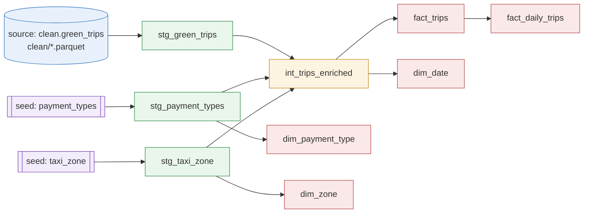

# NYC Green Taxi Data Pipeline

An **EtLT** pipeline that downloads NYC TLC Green Taxi trip records for January–March 2025, cleans them with Polars, models them in DuckDB with dbt, and calculates **revenue per day**. The whole run is orchestrated with Prefect.

**Stack:** Python 3.13 · uv · Polars · DuckDB · dbt (dbt-duckdb) · Prefect

## Architecture

```
NYC TLC (CloudFront)                                    DuckDB (data/nyc_taxi.duckdb)
        │                                                ┌───────────────────────────┐
        ▼  E: download_files.py                          │ seeds    payment_types,   │
data/green_taxi/raw/*.parquet                            │          taxi_zone        │
        │                                                │ staging  stg_* (views)    │
        ▼  t: clean_green_taxi.py (Polars)               │ intermed int_trips_enriched│
data/green_taxi/clean/*.parquet  ──── L + T: dbt ──────▶ │ marts    fact_trips,      │
data/green_taxi/rescue/*.parquet (rejected rows)         │          fact_daily_trips,│
                                                         │          dim_* (tables)    │
                                                         └───────────────────────────┘
        └──────────── orchestrated by pipeline_flow.py (Prefect) ────────────┘
```

**Why EtLT?** A light, row-level clean happens in Python before loading (fixing schema drift between months and quarantining bad rows), while the business transformations — joins, enrichment and aggregations — run inside the warehouse with dbt, where they are versioned, tested and documented.

## Project Structure

| Path | Description |
|---|---|
| `config.yaml` | Single source of settings: source URL, year/months, folder paths, Prefect schedule |
| `src/taxi_pipeline/config.py` | Loads `config.yaml` and resolves paths relative to the project root |
| `src/taxi_pipeline/download_files.py` | **Extract** – downloads monthly Parquet files to `data/green_taxi/raw` (skips files that already exist) |
| `src/taxi_pipeline/clean_green_taxi.py` | **Light transform** – standardises columns/types and splits rows into `clean` and `rescue` |
| `src/taxi_pipeline/pipeline_flow.py` | **Prefect flow** – runs extract → clean → `dbt deps` + `dbt build` |
| `nyc_taxi/` | dbt project (seeds, staging, intermediate and mart models, tests) |
| `data/` | Raw, clean and rescue Parquet files plus the DuckDB database (not committed) |
| `scripts/Analysis/` | Notebooks for data exploration and checking dbt outputs |

## Setup

Requires [uv](https://docs.astral.sh/uv/) and Python 3.13 (see `.python-version`).

```bash
git clone git@github.com:ponmalargs/mle_data_pipeline_project.git
cd mle_data_pipeline_project
uv sync
```

### dbt profile

dbt looks for a profile named `nyc_taxi` in `~/.dbt/profiles.yml`. Example:

```yaml
nyc_taxi:
  target: dev
  outputs:
    dev:
      type: duckdb
      path: ../data/nyc_taxi.duckdb   # relative to the nyc_taxi/ folder
      threads: 4
```

> [!NOTE]
> dbt reads the clean Parquet files from the `TAXI_CLEAN_DIR` environment variable.
> `taxi-run` sets it automatically from `paths.clean` in `config.yaml`. When you run
> dbt by hand without setting it, the default is `../data/green_taxi/clean`.

## Running the Pipeline

### Full pipeline (recommended)

```bash
uv run taxi-run                       # uses year/months from config.yaml
uv run taxi-run -y 2025 -m 1 -m 2     # override the period
```

### Step by step

```bash
uv run taxi-download -y 2025 -m 1 -m 2 -m 3   # 1. Extract
uv run taxi-clean    -y 2025 -m 1 -m 2 -m 3   # 2. Light transform
cd nyc_taxi
uv run dbt deps                               # 3. Install dbt_utils
uv run dbt build                              # 4. Seeds, models and tests
```

### Configuration

Edit `config.yaml` to change what gets processed. If `run.year` or `run.months` is left empty, the pipeline processes the month `lag_months` before today (TLC publishes data with a delay). The `prefect` section defines retries and a monthly schedule (`0 6 15 * *`, Europe/Berlin).

## Data Cleaning Rules

`clean_green_taxi.py` forces every month into the same schema (renaming e.g. `lpep_pickup_datetime` → `pickup_datetime`) and tags each row with the **first** rule it breaks:

| Reject reason | Rule |
|---|---|
| `missing_pickup_datetime` | Pickup time is null |
| `pickup_outside_file_month` | Pickup is not in the file's year/month |
| `dropoff_before_pickup` | Dropoff time is earlier than pickup |
| `duplicate` | Exact copy of an earlier row |

Valid rows go to `data/green_taxi/clean/`, rejected rows (with `reject_reason`) go to `data/green_taxi/rescue/`, so no data is silently lost. Both outputs get `source_file` and `loaded_at` lineage columns, and the script asserts `clean + rescue = raw`.

## dbt Models

| Layer | Model | Materialization | Purpose |
|---|---|---|---|
| Seeds | `payment_types`, `taxi_zone` | table | Lookup data for payment codes and TLC zones |
| Staging | `stg_green_trips` | view | Reads clean Parquet, adds `trip_id` (MD5 hash) and `trip_duration_min` |
| Staging | `stg_payment_types`, `stg_taxi_zone` | view | Typed and renamed lookups |
| Intermediate | `int_trips_enriched` | view | Joins payment and pickup/dropoff zones, adds date/hour parts and an `is_valid_trip` flag |
| Marts | `fact_trips` | table | One row per valid trip |
| Marts | `fact_daily_trips` | table | **Daily revenue** and KPIs per pickup borough: trips, revenue, avg fare, avg distance, avg duration, tip %, CBD fees |
| Marts | `dim_date`, `dim_zone`, `dim_payment_type` | table | Dimensions for reporting |

Tests cover uniqueness and not-null keys, relationships from facts to dimensions, and a `dbt_utils.unique_combination_of_columns` check on `(pickup_date, pickup_borough)`.

### Lineage



| From | To | How |
|---|---|---|
| Clean Parquet files | `stg_green_trips` | `source('clean', 'green_trips')` |
| Seeds | `stg_payment_types`, `stg_taxi_zone` | `ref()` to the seed CSVs |
| All three staging models | `int_trips_enriched` | Trips joined to payment type and to zones twice (pickup and dropoff) |
| `int_trips_enriched` | `fact_trips`, `dim_date` | Valid trips only (`is_valid_trip`); date range from min pickup to max dropoff |
| `stg_payment_types`, `stg_taxi_zone` | `dim_payment_type`, `dim_zone` | Direct selects |
| `fact_trips` | `fact_daily_trips` | Grouped by `pickup_date` and `pickup_borough` |

To explore the lineage interactively, generate dbt's docs site:

```bash
cd nyc_taxi
uv run dbt docs generate
uv run dbt docs serve      # opens http://localhost:8080 - click the lineage icon
```

### Revenue per day

```sql
select pickup_date, sum(revenue) as revenue
from marts.fact_daily_trips
group by pickup_date
order by pickup_date;
```

## Planned Add-ons

Ideas to pick up when there is time:

- [ ] **Run with Docker**: containerise the pipeline so it runs the same on any computer. Step-by-step guide: [docs/docker_addon.md](docs/docker_addon.md)

## Review Questions

**1. What steps did you take to complete the project?**
Explored the raw data in notebooks; wrote a download script for Jan–Mar 2025; built a Polars cleaning step with a rescue folder for rejected rows; set up a dbt project on DuckDB with staging, intermediate and mart layers; calculated daily revenue in `fact_daily_trips`; moved settings into `config.yaml`; and wrapped everything in a Prefect flow.

**2. What challenges did you face?**
Schema differences between monthly files (column names and types), trips whose pickup fell outside the file's month, and configuring dbt sources and schema names for DuckDB.

**3. What would you do differently with more time?**
Add unit tests for the download and cleaning steps (the `tests/` folder is empty) deploy the Prefect flow on its schedule, containerise the pipeline with Docker (see [Planned Add-ons](#planned-add-ons)), and add a dashboard on top of the marts. 

## Data Source

[NYC Taxi & Limousine Commission – Trip Record Data](https://www.nyc.gov/site/tlc/about/tlc-trip-record-data.page)

## License

See [LICENSE](LICENSE).
